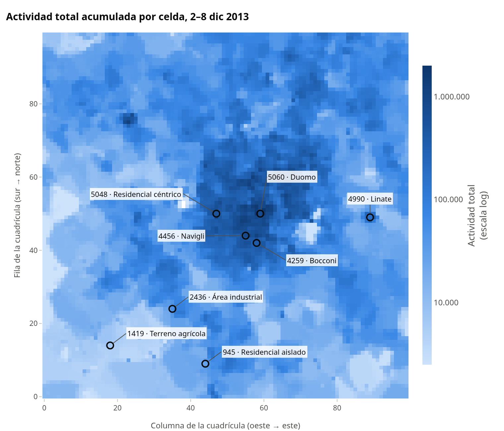
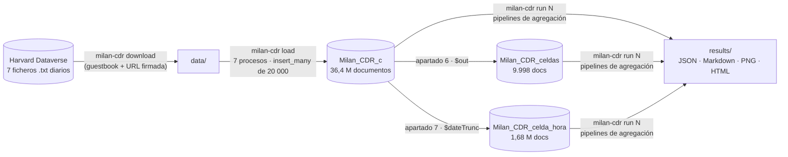
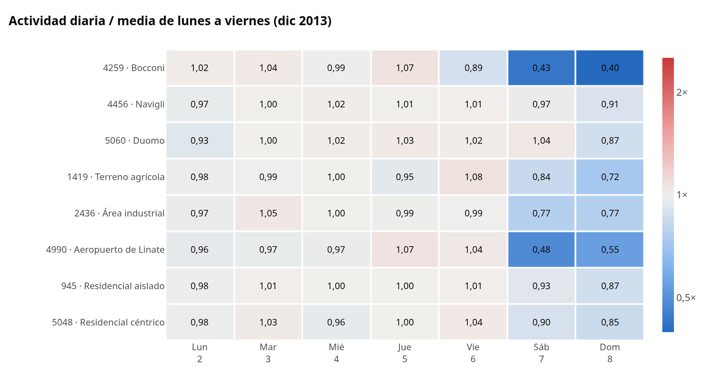
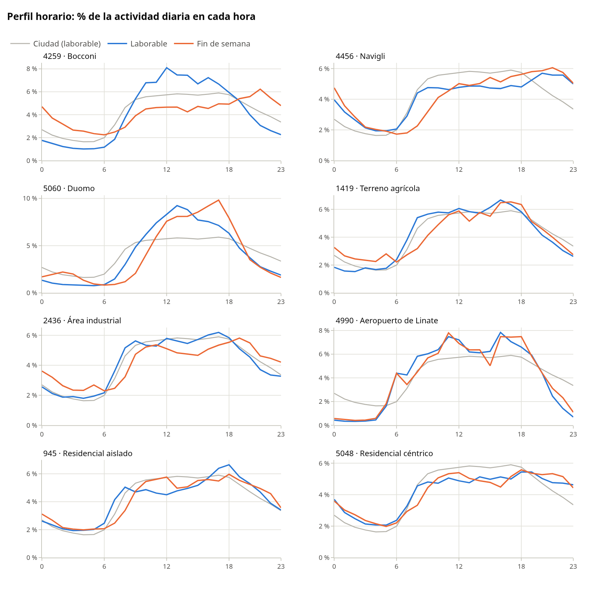
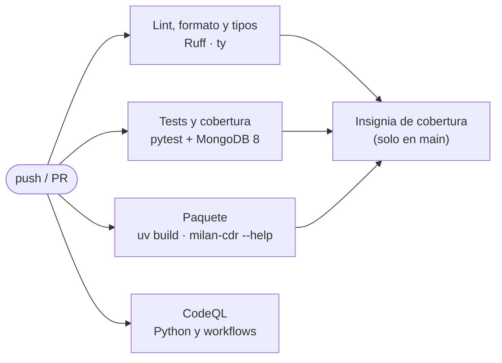

<div align="center">

# 📶 milan-cdr

**Carga y análisis con MongoDB de los CDR (*Call Detail Records*) de Milán** publicados por Telecom
Italia en el *Big Data Challenge*.

[](https://github.com/Pablo-Caballero-Maria/milan-cdr/actions/workflows/ci.yml)
[](https://github.com/Pablo-Caballero-Maria/milan-cdr/actions/workflows/codeql.yml)
[](https://github.com/Pablo-Caballero-Maria/milan-cdr/actions/workflows/ci.yml)
[](https://github.com/Pablo-Caballero-Maria/milan-cdr/releases)
[](LICENSE)
[](http://opendatacommons.org/licenses/odbl/1-0/)


-47A248?logo=mongodb&logoColor=white)


[Memoria (PDF)](memoria/memoria.pdf) ·
[Wiki](https://github.com/Pablo-Caballero-Maria/milan-cdr/wiki) ·
[Resultados](results/informe.md) ·
[Registro de cambios](CHANGELOG.md) ·
[Resumen en mi portfolio](https://pablo-portfolio-woad.vercel.app/projects/milan-cdr)



</div>

Dataset [doi:10.7910/DVN/EGZHFV](https://dataverse.harvard.edu/dataset.xhtml?persistentId=doi:10.7910/DVN/EGZHFV):
la actividad de la red móvil de Milán en una cuadrícula de 100 × 100 celdas, en intervalos de diez
minutos, con SMS y llamadas entrantes y salientes e internet por código de país.

Semana analizada: **lunes 2 a domingo 8 de diciembre de 2013** (36.362.524 registros), una semana
laborable seguida de un fin de semana especial: Sant'Ambrogio (patrón de Milán) el sábado y la
Inmaculada, fiesta nacional, el domingo.

| 🗂️ Registros | ⚡ Carga | 🌍 Países extranjeros | 🏙️ Celdas | 🔍 Barrios estudiados |
| :---: | :---: | :---: | :---: | :---: |
| 36,4 millones | ~95 s (7 procesos) | 217 | 9.998 con datos | 8, hora a hora |

La memoria (`CDRMilan.pdf` en la entrega), con las consultas y los resultados de cada apartado, está en
[`memoria/memoria.pdf`](memoria/memoria.pdf); el enunciado y la presentación del conjunto de datos de la
asignatura, en [`instrucciones/`](instrucciones/).

## Índice

- [Cómo funciona](#cómo-funciona)
- [Requisitos](#requisitos)
- [Uso](#uso)
- [Resultados destacados](#resultados-destacados)
- [Estructura](#estructura)
- [Calidad e integración continua](#calidad-e-integración-continua)
- [Documentación](#documentación)
- [Contribuir](#contribuir)
- [Cómo citar](#cómo-citar)
- [Licencias](#licencias)

## Cómo funciona



Cada línea del fichero se convierte en un documento: `time` se guarda como fecha BSON (no como
milisegundos) para poder usar los operadores de fecha de MongoDB en la zona horaria Europe/Rome, y los
campos de actividad vacíos se omiten (`$sum` ignora los ausentes, así que el resultado es el mismo y la
colección ocupa menos).

| Apartado | Qué pide el enunciado | Cómo se resuelve |
| :---: | --- | --- |
| 1 | Cargar la semana en `Milan_CDR_c` | carga masiva en paralelo (7 procesos), índices al final |
| 2 | Países con los que se interactúa | `$group` por `countrycode`; prefijo → país con `phonenumbers` y CLDR |
| 3 | País con el que más se interactúa, además de Italia | el mismo *ranking* sin Italia ni el código 0, por total y por SMS + llamadas |
| 4 | Celda que más se comunica con el extranjero | `$match` de países extranjeros y *ranking* por celda |
| 5 | Celda con más actividad de cada campo y en total | un solo `$group` por celda y un `$facet` que ordena en paralelo |
| 6 | Colección con un documento por celda | `$group` + `$out` → `Milan_CDR_celdas` (9.998 documentos, ~24 s) |
| 7 | Colección con un documento por celda y hora | `$dateTrunc` en Europe/Rome + `$out` → `Milan_CDR_celda_hora` (1.679.556, ~33 s) |
| 8 | Estudio de ocho celdas | `$setWindowFields` con `$rank`, `$topN`, perfiles horarios, fin de semana frente a laborables |

## Requisitos

- Python 3.14 y [uv](https://docs.astral.sh/uv/)
- Google Chrome o Chromium, que kaleido usa para exportar las figuras de Plotly a PNG
  (si no hay ninguno, `uv run plotly_get_chrome` descarga uno)
- Un servidor MongoDB ≥ 7.0 en `localhost:27017` (se usan `$median`, `$topN`, `$dateTrunc` y
  `$setWindowFields`). Probado con MongoDB 8.3.

```bash
uv sync                    # crea el entorno e instala dependencias
```

## Uso

```bash
# Apartado 1: descarga (Dataverse exige un email en su "guestbook") y carga
uv run milan-cdr download --email tu@correo.es
uv run milan-cdr load                   # 7 procesos en paralelo, unos 95 s

# Apartados 2-8 por separado
uv run milan-cdr run 2

# Todo: resultados en results/ (JSON + Markdown + figuras)
uv run milan-cdr report

# Solo las figuras (PNG para la memoria + HTML interactivo)
uv run milan-cdr figures
```

> [!TIP]
> La configuración se puede cambiar con variables de entorno `MILAN_CDR_*` (`MONGO_URI`, `DB`,
> `COLLECTION`, `WEEK_START`, `DATA_DIR`, `RESULTS_DIR`…); ver `src/milan_cdr/config.py`.

Colecciones que se crean en `Milan_CDR_db`:

| Colección | Contenido |
| --- | --- |
| `Milan_CDR_c` | un documento por línea de los ficheros (apartado 1) |
| `Milan_CDR_celdas` | un documento por celda con los acumulados (apartado 6) |
| `Milan_CDR_celda_hora` | un documento por celda y hora con los acumulados (apartado 7) |

## Resultados destacados

Todos los resultados están en [results/informe.md](results/informe.md) y en la memoria.

- **¿Con quién habla Milán?** Francia encabeza la actividad total, sobre todo por internet (tarjetas SIM
  extranjeras: visitantes en *roaming*); Egipto, la comunicación entre personas, con un 85 % de llamadas
  salientes y casi nada de internet: gente que vive en Milán y llama a casa.
- **La celda 5161**, en diagonal con la del Duomo, tiene la mayor actividad total, de internet y con el
  extranjero; su vecina al oeste, la **5059**, es la primera en SMS recibidos y en llamadas entrantes y
  salientes. Los SMS salientes los encabeza la **4756**, que envía el triple de los que recibe
  (probablemente un emisor masivo).
- **Ocho barrios, ocho ritmos**: la Bocconi sigue el horario de clases y el fin de semana cae al 41 % de
  un día laborable; los Navigli tienen el pico a las 20 h; Linate vive al ritmo de los vuelos y tiene el
  mayor tráfico extranjero (4,3 %).

<details>
<summary><b>Los cinco países extranjeros con más actividad</b></summary>

| País | SMS + llamadas | Internet | Total |
| --- | ---: | ---: | ---: |
| 🇫🇷 Francia | 220.572 | 253.595 | 474.168 |
| 🇬🇧 Reino Unido | 248.574 | 192.967 | 441.540 |
| 🇩🇪 Alemania | 131.212 | 306.345 | 437.557 |
| 🇨🇭 Suiza | 224.736 | 109.119 | 333.856 |
| 🇪🇬 Egipto | 264.659 | 2.176 | 266.835 |

Los valores del dataset son proporcionales al número de eventos, pero solo tienen sentido comparados entre
sí: tras la anonimización de Telecom Italia, un evento parece pesar alrededor de π.

</details>

<p align="center">
  
  
</p>

## Estructura

```
src/milan_cdr/
  config.py      constantes del dominio y Settings
  dataverse.py   descarga desde Harvard Dataverse (guestbook + URL firmada)
  documents.py   esquema tipado: el TypedDict de cada colección y sus Collection[...]
  parsing.py     línea .txt -> documento (time como Date, campos vacíos omitidos)
  loader.py      carga masiva en paralelo + índices          (apartado 1)
  pipelines.py   pipelines de agregación, funciones puras,    (apartados 2-8)
                 con etapas tipadas ($match, $group, $facet…)
  analysis.py    ejecución de los apartados 2-7
  study.py       estudio de las 8 celdas                      (apartado 8)
  countries.py   prefijo telefónico -> país (phonenumbers + CLDR)
  plots.py       figuras (plotly; PNG con kaleido + HTML)
  report.py      salida por consola, JSON y Markdown
  cli.py         CLI `milan-cdr` (typer)
tests/           tests unitarios + integración contra MongoDB real
results/         informe.md, resultados.json y figuras/ (PNG + HTML interactivo)
memoria/         la memoria del trabajo (memoria.pdf, entregada como CDRMilan.pdf)
instrucciones/   enunciado y presentación del conjunto de datos (material de la asignatura)
```

Las consultas están tipadas: cada colección (`Milan_CDR_c`, `Milan_CDR_celdas` y `Milan_CDR_celda_hora`) se usa
como un `Collection[...]` de PyMongo con el `TypedDict` de su documento (`documents.py`), y cada etapa de un
pipeline es un `TypedDict` de su operador, de modo que `ty` comprueba los documentos que se insertan, los campos
que se leen de los resultados y que ninguna etapa lleve un operador mal escrito. Los pipelines siguen siendo los
mismos diccionarios que en `mongosh`.

## Calidad e integración continua

```bash
uv run ruff check . && uv run ruff format --check .   # lint + formato
uv run ty check                                        # tipos
uv run pytest --cov                                    # tests (+ doctests) con cobertura
uv build                                               # wheel y sdist en dist/
```

Los tests de integración (`-m mongo`) crean una base de datos temporal con una semana sintética,
ejecutan cada pipeline y comparan el resultado con la misma agregación hecha en Python. Si no hay
servidor MongoDB se saltan (`MILAN_CDR_TEST_URI` permite usar otro).

Cada *push* y *pull request* pasa por [GitHub Actions](https://github.com/Pablo-Caballero-Maria/milan-cdr/actions):



Además: Dependabot (uv y GitHub Actions) y escaneo de secretos con protección al hacer *push*.

## Documentación

La [wiki](https://github.com/Pablo-Caballero-Maria/milan-cdr/wiki) amplía cada parte:

| Página | Contenido |
| --- | --- |
| [El conjunto de datos](https://github.com/Pablo-Caballero-Maria/milan-cdr/wiki/El-conjunto-de-datos) | qué mide cada campo, la cuadrícula, la anonimización y la semana elegida |
| [Carga en MongoDB](https://github.com/Pablo-Caballero-Maria/milan-cdr/wiki/Carga-en-MongoDB) | parseo, carga en paralelo, índices y tiempos |
| [Consultas por apartado](https://github.com/Pablo-Caballero-Maria/milan-cdr/wiki/Consultas-por-apartado) | los pipelines de los apartados 2 a 8 |
| [Resultados](https://github.com/Pablo-Caballero-Maria/milan-cdr/wiki/Resultados) | países, celdas y los ocho barrios |
| [Desarrollo y pruebas](https://github.com/Pablo-Caballero-Maria/milan-cdr/wiki/Desarrollo-y-pruebas) | entorno, tests, cobertura, CI y versiones |
| [Preguntas frecuentes](https://github.com/Pablo-Caballero-Maria/milan-cdr/wiki/Preguntas-frecuentes) | dudas habituales |

## Contribuir

- Abre un *issue* con la plantilla adecuada: [error](https://github.com/Pablo-Caballero-Maria/milan-cdr/issues/new?template=bug_report.yml),
  [mejora](https://github.com/Pablo-Caballero-Maria/milan-cdr/issues/new?template=feature_request.yml) o
  [resultado que no coincide con la memoria](https://github.com/Pablo-Caballero-Maria/milan-cdr/issues/new?template=resultado_distinto.yml).
- Los *pull requests* siguen la [plantilla](.github/pull_request_template.md) y tienen que pasar la CI.
- Toda la participación se rige por el [código de conducta](CODE_OF_CONDUCT.md); los problemas de
  seguridad se informan en privado ([SECURITY.md](SECURITY.md)).

## Cómo citar

Usa los metadatos de [CITATION.cff](CITATION.cff) (*Cite this repository* en GitHub) y cita también el
conjunto de datos:

<details>
<summary>BibTeX</summary>

```bibtex
@software{caballero_maria_milan_cdr_2026,
  author  = {Caballero María, Pablo},
  title   = {milan-cdr: carga y análisis con MongoDB de los CDR de Milán},
  year    = {2026},
  version = {1.0.1},
  url     = {https://github.com/Pablo-Caballero-Maria/milan-cdr},
  license = {MIT}
}

@data{telecomitalia_milano_2015,
  author    = {{Telecom Italia}},
  title     = {Telecommunications - SMS, Call, Internet - MI},
  publisher = {Harvard Dataverse},
  year      = {2015},
  doi       = {10.7910/DVN/EGZHFV}
}
```

</details>

## Licencias

- **Código**: [MIT](LICENSE).
- **Datos**: bajo [ODbL 1.0](http://opendatacommons.org/licenses/odbl/1-0/), "from BigDataChallenge
  contest" (Telecom Italia). Los ficheros originales no se incluyen en el repositorio; `results/`
  contiene resultados derivados de ellos.
- `instrucciones/` (el enunciado y la presentación `BaseDeDatosCDRMilan.pdf`) es material de la
  asignatura y pertenece a sus autores; no está cubierto por la licencia MIT.
