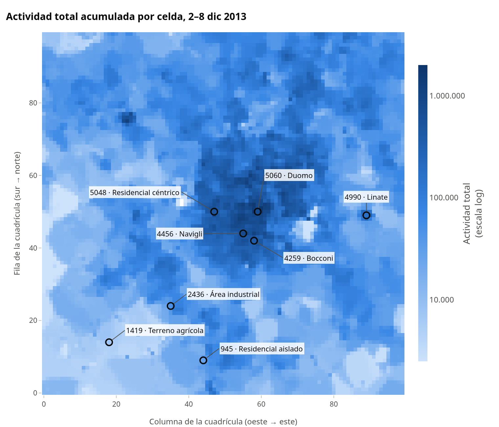
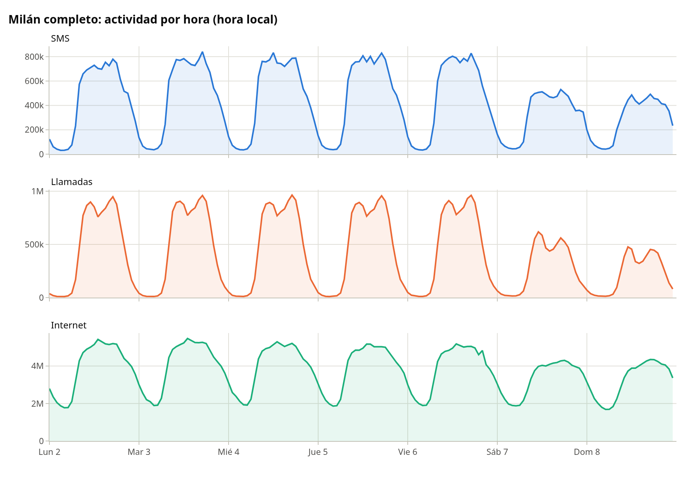
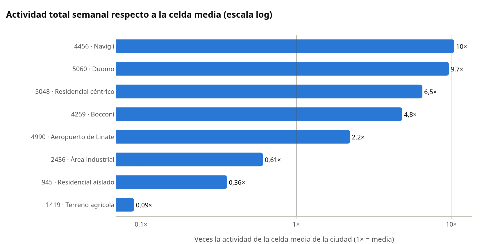
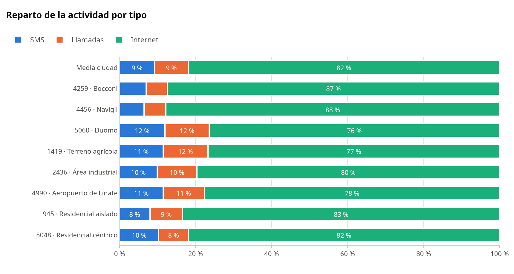
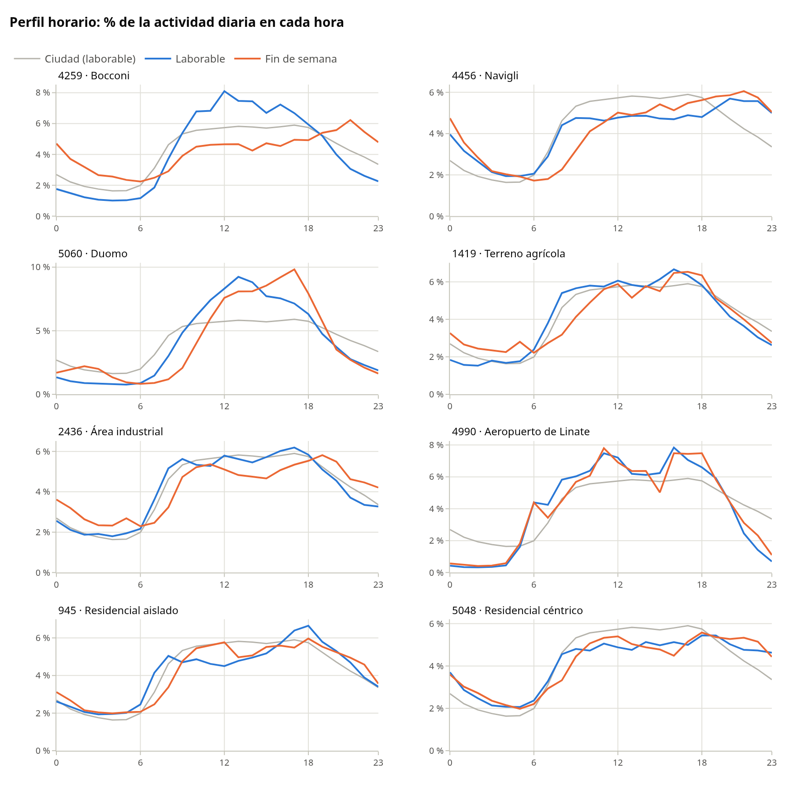
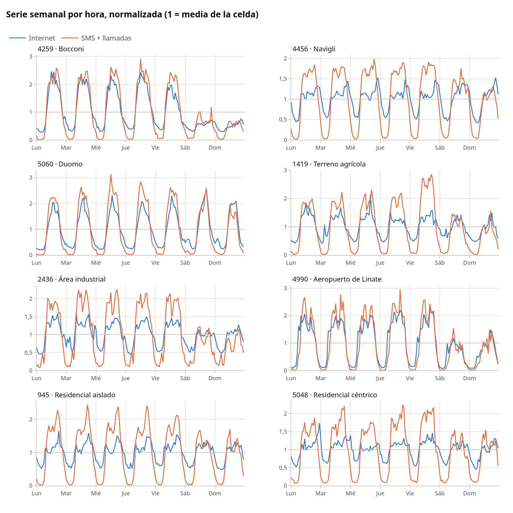
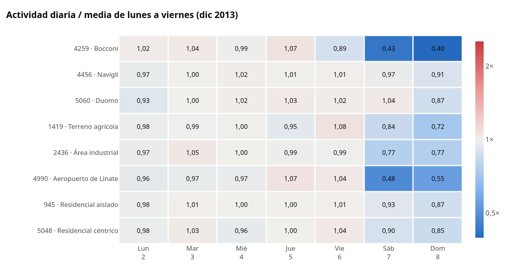

# Resultados CDR Milán (2–8 dic 2013)

## Apartado 2

305 códigos distintos, 218 países.

| _id | pais | registros | smsin | smsout | callin | callout | internet | sms_llamadas | total |
|---|---|---|---|---|---|---|---|---|---|
| 39 | Italia | 10.074.691 | 30.966.487,51 | 22.880.452,90 | 31.230.786,93 | 34.933.208,21 | 630.296.302,16 | 120.010.935,55 | 750.307.237,71 |
| 0 | Desconocido (código 0) | 7.952.982 | 14.598.940,04 | 1.034.729,51 | 96.876,34 | 488.632,12 | 365,95 | 16.219.178,00 | 16.219.543,95 |
| 33 | Francia | 1.812.473 | 81.913,74 | 53.165,58 | 46.716,40 | 38.776,75 | 253.595,21 | 220.572,46 | 474.167,66 |
| 44 | Reino Unido | 951.511 | 88.878,04 | 90.766,44 | 36.513,23 | 32.415,82 | 192.966,52 | 248.573,53 | 441.540,05 |
| 49 | Alemania | 1.843.975 | 56.814,96 | 23.874,02 | 29.904,86 | 20.617,80 | 306.345,24 | 131.211,65 | 437.556,88 |
| 41 | Suiza | 1.031.977 | 72.002,96 | 42.851,73 | 61.531,91 | 48.349,68 | 109.119,35 | 224.736,29 | 333.855,63 |
| 20 | Egipto | 978.940 | 28.541,59 | 3.403,10 | 7.161,57 | 225.552,96 | 2.175,62 | 264.659,22 | 266.834,84 |
| 1 | Estados Unidos | 507.406 | 49.072,14 | 16.006,74 | 16.228,53 | 12.641,07 | 146.556,17 | 93.948,48 | 240.504,65 |
| 46 | Suecia | 1.494.065 | 7.562,82 | 4.774,60 | 3.246,18 | 3.743,40 | 194.205,20 | 19.327,00 | 213.532,20 |
| 34 | España | 566.995 | 21.951,09 | 11.426,10 | 26.751,82 | 18.327,14 | 99.960,99 | 78.456,14 | 178.417,13 |
| 86 | China | 424.616 | 37.692,37 | 14.034,45 | 14.107,62 | 66.261,98 | 22.517,18 | 132.096,41 | 154.613,59 |
| 7 | Rusia | 258.218 | 54.612,00 | 34.302,13 | 22.950,12 | 15.184,66 | 24.740,77 | 127.048,90 | 151.789,67 |
| 40 | Rumanía | 695.882 | 33.633,62 | 11.471,50 | 22.046,08 | 47.617,47 | 24.610,23 | 114.768,67 | 139.378,90 |
| 32 | Bélgica | 690.401 | 13.496,49 | 8.259,58 | 6.291,04 | 5.674,77 | 103.616,00 | 33.721,87 | 137.337,87 |
| 880 | Bangladés | 334.439 | 5.366,77 | 358,88 | 654,90 | 114.198,35 | 0 | 120.578,90 | 120.578,90 |
| 380 | Ucrania | 581.791 | 10.173,46 | 4.330,28 | 8.317,93 | 96.620,14 | 524,48 | 119.441,82 | 119.966,30 |
| 48 | Polonia | 604.677 | 34.526,14 | 18.230,76 | 15.426,60 | 10.446,96 | 30.447,60 | 78.630,46 | 109.078,05 |
| 63 | Filipinas | 274.123 | 38.299,50 | 2.530,24 | 808,06 | 49.358,64 | 0 | 90.996,44 | 90.996,44 |
| 94 | Sri Lanka | 257.645 | 12.643,53 | 1.425,18 | 6.939,19 | 49.663,55 | 0 | 70.671,46 | 70.671,46 |
| 43 | Austria | 377.968 | 11.689,97 | 4.260,04 | 6.570,13 | 4.746,20 | 35.131,64 | 27.266,35 | 62.397,99 |
| 90 | Turquía | 170.199 | 11.617,51 | 4.764,41 | 8.095,27 | 2.703,13 | 31.524,62 | 27.180,33 | 58.704,95 |
| 420 | Chequia | 251.105 | 18.897,92 | 10.613,59 | 5.033,49 | 3.236,32 | 15.609,19 | 37.781,32 | 53.390,51 |
| 221 | Senegal | 268.130 | 3.698,47 | 245,52 | 8.225,61 | 38.359,42 | 0 | 50.529,02 | 50.529,02 |
| 31 | Países Bajos | 192.505 | 7.197,21 | 4.861,49 | 6.442,89 | 5.294,73 | 24.110,77 | 23.796,31 | 47.907,08 |
| 353 | Irlanda | 316.003 | 4.274,19 | 2.674,32 | 3.275,53 | 1.319,77 | 32.225,96 | 11.543,81 | 43.769,77 |
| 593 | Ecuador | 181.410 | 2.032,32 | 298,45 | 4.466,87 | 29.093,99 | 201,41 | 35.891,64 | 36.093,05 |
| 55 | Brasil | 92.344 | 6.841,70 | 4.703,46 | 4.648,87 | 8.462,20 | 10.074,81 | 24.656,24 | 34.731,05 |
| 212 | Marruecos | 179.555 | 4.417,86 | 2.034,07 | 6.402,06 | 20.690,50 | 286,14 | 33.544,49 | 33.830,63 |
| 30 | Grecia | 101.302 | 7.833,79 | 4.074,30 | 7.412,92 | 6.134,10 | 7.324,06 | 25.455,11 | 32.779,17 |
| 36 | Hungría | 112.298 | 11.105,14 | 5.253,63 | 5.829,17 | 2.816,73 | 4.891,30 | 25.004,67 | 29.895,97 |
| 421 | Eslovaquia | 170.245 | 8.281,47 | 3.784,14 | 3.070,48 | 1.645,45 | 11.764,68 | 16.781,54 | 28.546,22 |
| 355 | Albania | 129.498 | 7.917,62 | 2.358,15 | 4.874,83 | 10.908,10 | 1.096,59 | 26.058,69 | 27.155,29 |
| 91 | India | 112.894 | 5.872,31 | 2.317,89 | 4.205,42 | 11.721,59 | 1.816,63 | 24.117,20 | 25.933,83 |
| 51 | Perú | 107.110 | 2.661,56 | 688,62 | 2.047,42 | 19.136,58 | 113,10 | 24.534,18 | 24.647,27 |
| 385 | Croacia | 83.970 | 8.375,14 | 4.122,16 | 3.187,07 | 3.565,56 | 3.838,27 | 19.249,94 | 23.088,21 |
| 216 | Túnez | 114.134 | 4.331,02 | 1.593,52 | 5.048,26 | 7.779,81 | 3.799,67 | 18.752,61 | 22.552,28 |
| 852 | RAE de Hong Kong (China) | 34.845 | 1.691,87 | 952,62 | 1.426,42 | 1.479,44 | 16.045,08 | 5.550,34 | 21.595,42 |
| 359 | Bulgaria | 118.488 | 5.085,89 | 2.125,51 | 5.936,85 | 4.596,64 | 3.029,43 | 17.744,89 | 20.774,33 |
| 45 | Dinamarca | 70.711 | 4.545,81 | 3.158,38 | 1.889,01 | 2.259,63 | 8.104,33 | 11.852,83 | 19.957,15 |
| 351 | Portugal | 112.027 | 3.232,40 | 2.133,60 | 2.507,72 | 2.201,30 | 9.520,38 | 10.075,03 | 19.595,41 |
| 972 | Israel | 40.046 | 5.800,67 | 1.822,56 | 4.564,71 | 1.238,71 | 5.083,82 | 13.426,66 | 18.510,48 |
| 370 | Lituania | 91.430 | 6.055,91 | 4.163,90 | 2.428,57 | 1.429,83 | 4.048,31 | 14.078,20 | 18.126,52 |
| 358 | Finlandia | 29.383 | 4.047,35 | 2.946,23 | 1.088,55 | 1.216,20 | 8.582,57 | 9.298,33 | 17.880,90 |
| 373 | Moldavia | 81.623 | 2.884,47 | 1.024,38 | 2.197,82 | 11.401,70 | 59,64 | 17.508,37 | 17.568,00 |
| 81 | Japón | 33.438 | 618,26 | 402,16 | 1.569,13 | 1.614,22 | 13.186,83 | 4.203,76 | 17.390,58 |
| 372 | Estonia | 50.262 | 2.759,23 | 2.355,47 | 4.159,76 | 981,40 | 7.048,94 | 10.255,86 | 17.304,80 |
| 381 | Serbia | 51.373 | 8.135,13 | 3.888,23 | 1.965,76 | 2.012,99 | 823,04 | 16.002,10 | 16.825,14 |
| 61 | Australia | 46.476 | 4.791,80 | 3.661,40 | 1.577,56 | 1.305,48 | 4.808,69 | 11.336,24 | 16.144,93 |
| 352 | Luxemburgo | 57.427 | 2.533,09 | 1.855,02 | 1.998,84 | 1.393,30 | 8.274,16 | 7.780,26 | 16.054,42 |
| 47 | Noruega | 40.990 | 3.212,63 | 2.300,40 | 1.378,31 | 1.822,47 | 6.949,67 | 8.713,81 | 15.663,47 |
| 971 | Emiratos Árabes Unidos | 47.245 | 4.028,80 | 3.014,19 | 4.328,09 | 1.778,96 | 2.123,28 | 13.150,04 | 15.273,32 |
| 371 | Letonia | 52.808 | 3.955,56 | 2.543,82 | 2.036,74 | 1.260,89 | 4.319,12 | 9.797,01 | 14.116,13 |
| 92 | Pakistán | 73.590 | 1.801,08 | 343,84 | 817,91 | 9.910,76 | 6,28 | 12.873,59 | 12.879,88 |
| 98 | Irán | 21.607 | 7.960,32 | 1.822,16 | 1.140,27 | 1.105,23 | 3,14 | 12.027,98 | 12.031,12 |
| 386 | Eslovenia | 58.783 | 3.562,10 | 2.099,66 | 2.295,02 | 2.023,09 | 1.490,45 | 9.979,86 | 11.470,31 |
| 53 | Cuba | 47.049 | 4.746,89 | 4.536,44 | 651,68 | 1.089,12 | 0 | 11.024,12 | 11.024,12 |
| 82 | Corea del Sur | 30.438 | 4.413,20 | 152,76 | 1.093,69 | 554,17 | 4.593,67 | 6.213,82 | 10.807,49 |
| 230 | Mauricio | 38.446 | 3.054,71 | 1.173,48 | 1.871,11 | 4.649,69 | 0 | 10.748,99 | 10.748,99 |
| 54 | Argentina | 26.497 | 2.329,93 | 1.309,27 | 1.244,60 | 1.347,67 | 4.251,38 | 6.231,48 | 10.482,85 |
| 505 | Nicaragua | 6.462 | 1.231,26 | 339,29 | 232,41 | 437,10 | 8.076,17 | 2.240,07 | 10.316,23 |
| 234 | Nigeria | 44.635 | 1.642,83 | 497,67 | 2.501,65 | 4.991,11 | 307,85 | 9.633,26 | 9.941,11 |
| 66 | Tailandia | 23.324 | 1.160,87 | 772,84 | 1.254,11 | 956,32 | 4.670,94 | 4.144,14 | 8.815,08 |
| 62 | Indonesia | 19.013 | 3.321,72 | 1.675,25 | 452,34 | 258,47 | 1.541,54 | 5.707,78 | 7.249,31 |
| 88239 | Servicio internacional no geográfico | 45.752 | 0 | 0 | 0 | 0 | 6.839,90 | 0 | 6.839,90 |
| 65 | Singapur | 17.179 | 2.832,19 | 1.251,89 | 778,59 | 625,14 | 1.321,20 | 5.487,81 | 6.809,01 |
| 966 | Arabia Saudí | 18.928 | 1.383,50 | 477,34 | 2.354,52 | 866,42 | 1.682,01 | 5.081,78 | 6.763,79 |
| 58 | Venezuela | 24.074 | 2.698,33 | 1.358,74 | 1.175,31 | 995,64 | 351,86 | 6.228,03 | 6.579,89 |
| 213 | Argelia | 29.719 | 1.240,91 | 569,42 | 2.006,82 | 2.006,96 | 701,70 | 5.824,12 | 6.525,81 |
| 356 | Malta | 17.692 | 2.204,07 | 1.342,59 | 872,75 | 468,04 | 1.502,75 | 4.887,46 | 6.390,21 |
| 60 | Malasia | 13.024 | 1.670,28 | 765,28 | 461,66 | 269,12 | 3.109,36 | 3.166,34 | 6.275,70 |
| 1416 | Canadá | 12.525 | 724,64 | 505,81 | 166,62 | 334,23 | 4.533,46 | 1.731,30 | 6.264,77 |
| 218 | Libia | 22.605 | 1.446,87 | 292,29 | 1.507,58 | 2.135,06 | 0 | 5.381,80 | 5.381,80 |
| 375 | Bielorrusia | 19.669 | 2.120,44 | 1.428,27 | 560,78 | 851,16 | 295,35 | 4.960,65 | 5.256,00 |
| 233 | Ghana | 25.933 | 732,79 | 353,16 | 1.451,08 | 2.513,45 | 0 | 5.050,48 | 5.050,48 |
| 974 | Catar | 15.305 | 774,49 | 408,30 | 488,85 | 512,13 | 2.638,27 | 2.183,77 | 4.822,03 |
| 1514 | Canadá | 13.976 | 1.089,42 | 879,36 | 234,96 | 467,06 | 2.044,46 | 2.670,80 | 4.715,26 |
| 357 | Chipre | 12.723 | 1.862,87 | 917,90 | 752,17 | 664,56 | 427,78 | 4.197,51 | 4.625,29 |
| 7701 | Kazajistán | 16.138 | 1.027,99 | 832,03 | 412,67 | 320,78 | 2.030,89 | 2.593,46 | 4.624,35 |
| 503 | El Salvador | 17.397 | 1.370,86 | 1.370,88 | 469,10 | 1.408,74 | 0 | 4.619,58 | 4.619,58 |
| 27 | Sudáfrica | 14.948 | 1.797,05 | 1.071,88 | 777,10 | 470,61 | 72,26 | 4.116,64 | 4.188,90 |
| 254 | Kenia | 14.870 | 1.584,46 | 1.259,84 | 764,11 | 334,94 | 9,42 | 3.943,36 | 3.952,78 |
| 961 | Líbano | 11.017 | 1.163,83 | 578,98 | 854,82 | 1.023,53 | 164,66 | 3.621,16 | 3.785,82 |
| 389 | Macedonia del Norte | 9.413 | 1.816,74 | 723,29 | 324,29 | 574,30 | 47,19 | 3.438,62 | 3.485,81 |
| 994 | Azerbaiyán | 5.367 | 773,82 | 581,26 | 1.528,57 | 402,96 | 141,37 | 3.286,61 | 3.427,98 |
| 995 | Georgia | 11.181 | 700,83 | 358,27 | 936,89 | 1.297,13 | 12,57 | 3.293,12 | 3.305,68 |
| 387 | Bosnia y Herzegovina | 15.947 | 1.388,13 | 796,31 | 421,45 | 599,95 | 22,87 | 3.205,84 | 3.228,71 |
| 382 | Montenegro | 7.010 | 1.174,02 | 769,70 | 612,26 | 358,25 | 204,16 | 2.914,23 | 3.118,39 |
| 258 | Mozambique | 9.790 | 1.191,19 | 566,90 | 133,71 | 170,81 | 1.035,21 | 2.062,61 | 3.097,83 |
| 591 | Bolivia | 11.382 | 169,73 | 80,18 | 291,48 | 2.234,87 | 9,42 | 2.776,26 | 2.785,68 |
| 64 | Nueva Zelanda | 5.901 | 559,09 | 492,03 | 186,88 | 92,04 | 1.419,88 | 1.330,04 | 2.749,91 |
| 1403 | Canadá | 9.443 | 694,31 | 490,69 | 27,30 | 72,82 | 1.190,18 | 1.285,12 | 2.475,30 |
| 57 | Colombia | 8.745 | 144,50 | 122,54 | 219,82 | 1.838,16 | 84,82 | 2.325,02 | 2.409,84 |
| 84 | Vietnam | 9.438 | 628,08 | 560,47 | 316,90 | 163,26 | 713,56 | 1.668,71 | 2.382,28 |
| 1647 | Canadá | 6.713 | 615,51 | 278,89 | 88,37 | 151,12 | 1.130,92 | 1.133,89 | 2.264,81 |
| 886 | Taiwán | 5.938 | 664,09 | 260,81 | 522,81 | 226,95 | 282,34 | 1.674,66 | 1.957,00 |
| 377 | Mónaco | 7.867 | 210,45 | 145,64 | 735,15 | 861,31 | 0 | 1.952,55 | 1.952,55 |
| 354 | Islandia | 4.062 | 307,83 | 213,63 | 190,57 | 135,84 | 1.061,86 | 847,87 | 1.909,72 |
| 52 | México | 6.230 | 433,77 | 264,90 | 562,06 | 329,70 | 309,61 | 1.590,43 | 1.900,05 |
| 226 | Burkina Faso | 10.014 | 357,56 | 164,33 | 302,82 | 1.021,45 | 0 | 1.846,16 | 1.846,16 |
| 241 | Gabón | 3.909 | 626,98 | 621,93 | 460,58 | 59,64 | 0 | 1.769,12 | 1.769,12 |
| 56 | Chile | 4.274 | 182,12 | 100,49 | 330,65 | 458,63 | 552,70 | 1.071,89 | 1.624,59 |
| 1829 | República Dominicana | 9.235 | 357,45 | 87,37 | 174,56 | 975,87 | 0 | 1.595,26 | 1.595,26 |
| 598 | Uruguay | 5.714 | 675,43 | 354,63 | 298,30 | 188,25 | 6,28 | 1.516,60 | 1.522,89 |
| 242 | Congo | 6.567 | 329,43 | 215,45 | 534,25 | 210,10 | 175,62 | 1.289,24 | 1.464,85 |
| 968 | Omán | 3.447 | 582,17 | 338,34 | 284,44 | 169,68 | 75,40 | 1.374,63 | 1.450,03 |
| 243 | República Democrática del Congo | 6.837 | 350,86 | 290,77 | 578,03 | 162,49 | 0 | 1.382,15 | 1.382,15 |
| 225 | Côte d’Ivoire | 7.124 | 282,47 | 88,55 | 527,30 | 378,51 | 34,99 | 1.276,83 | 1.311,82 |
| 965 | Kuwait | 4.434 | 408,33 | 122,65 | 382,79 | 317,48 | 72,84 | 1.231,25 | 1.304,09 |
| 244 | Angola | 3.963 | 468,91 | 385,26 | 248,97 | 116,20 | 0 | 1.219,34 | 1.219,34 |
| 962 | Jordania | 3.828 | 296,81 | 62,83 | 317,28 | 329,81 | 163,36 | 1.006,74 | 1.170,10 |
| 507 | Panamá | 6.573 | 75,40 | 12,57 | 351,87 | 162,42 | 479,86 | 602,25 | 1.082,11 |
| 237 | Camerún | 5.062 | 160,49 | 91,11 | 469,03 | 337,19 | 0 | 1.057,82 | 1.057,82 |
| 255 | Tanzania | 5.942 | 348,19 | 396,76 | 138,07 | 113,08 | 0 | 996,10 | 996,10 |
| 251 | Etiopía | 4.417 | 194,74 | 135,09 | 396,58 | 229,33 | 0 | 955,73 | 955,73 |
| 1214 | Estados Unidos | 1.946 | 194,78 | 122,52 | 72,26 | 59,68 | 471,80 | 449,24 | 921,04 |
| 1778 | Canadá | 3.088 | 62,72 | 49,00 | 56,55 | 37,70 | 691,12 | 205,97 | 897,08 |
| 1604 | Canadá | 1.841 | 131,95 | 91,11 | 65,97 | 84,80 | 478,81 | 373,82 | 852,64 |
| 504 | Honduras | 3.851 | 376,02 | 127,18 | 201,71 | 40,82 | 0 | 745,75 | 745,75 |
| 93 | Afganistán | 2.757 | 285,73 | 210,03 | 208,26 | 31,47 | 9,42 | 735,48 | 744,91 |
| 973 | Baréin | 2.115 | 113,10 | 119,38 | 163,04 | 75,40 | 248,19 | 470,92 | 719,11 |
| 1808 | Estados Unidos | 2.926 | 109,96 | 0 | 12,57 | 25,13 | 534,07 | 147,65 | 681,73 |
| 964 | Irak | 3.482 | 203,28 | 88,05 | 183,06 | 169,67 | 36,58 | 644,06 | 680,64 |
| 229 | Benín | 3.943 | 112,69 | 6,28 | 349,57 | 207,66 | 0 | 676,20 | 676,20 |
| 853 | RAE de Macao (China) | 834 | 474,29 | 87,96 | 31,42 | 40,84 | 31,42 | 634,51 | 665,93 |
| 228 | Togo | 2.781 | 188,03 | 63,17 | 359,57 | 53,38 | 0 | 664,15 | 664,15 |
| 1613 | Canadá | 1.551 | 115,61 | 53,99 | 18,86 | 34,56 | 440,54 | 223,02 | 663,56 |
| 374 | Armenia | 1.678 | 161,23 | 91,13 | 371,80 | 34,57 | 0 | 658,73 | 658,73 |
| 261 | Madagascar | 2.928 | 290,73 | 163,34 | 138,56 | 47,12 | 0 | 639,75 | 639,75 |
| 238 | Cabo Verde | 2.300 | 225,83 | 126,55 | 205,31 | 76,74 | 0 | 634,42 | 634,42 |
| 976 | Mongolia | 1.009 | 383,27 | 213,78 | 25,14 | 6,28 | 0 | 628,48 | 628,48 |
| 7775 | Kazajistán | 1.626 | 320,64 | 121,38 | 97,39 | 69,12 | 0 | 608,52 | 608,52 |
| 7702 | Kazajistán | 1.100 | 257,69 | 75,35 | 84,80 | 175,82 | 3,14 | 593,65 | 596,79 |
| 1519 | Canadá | 1.870 | 125,30 | 83,39 | 15,71 | 12,57 | 330,40 | 236,97 | 567,37 |
| 998 | Uzbekistán | 1.027 | 103,67 | 103,67 | 100,53 | 225,61 | 0 | 533,49 | 533,49 |
| 7777 | Kazajistán | 2.170 | 185,71 | 81,63 | 102,67 | 151,54 | 0 | 521,55 | 521,55 |
| 960 | Maldivas | 2.003 | 242,66 | 165,71 | 75,24 | 18,85 | 0 | 502,46 | 502,46 |
| 291 | Eritrea | 2.201 | 40,84 | 3,14 | 303,76 | 141,28 | 0 | 489,02 | 489,02 |
| 220 | Gambia | 3.914 | 81,19 | 3,14 | 333,68 | 50,29 | 0 | 468,30 | 468,30 |
| 963 | Siria | 1.907 | 125,66 | 37,70 | 75,41 | 219,88 | 0 | 458,64 | 458,64 |
| 1849 | República Dominicana | 1.653 | 61,23 | 21,83 | 43,97 | 323,59 | 0 | 450,61 | 450,61 |
| 1587 | Canadá | 3.270 | 24,39 | 3,14 | 18,42 | 18,43 | 372,85 | 64,38 | 437,23 |
| 1780 | Canadá | 980 | 91,11 | 69,12 | 28,20 | 21,99 | 216,49 | 210,41 | 426,90 |
| 1787 | Puerto Rico | 562 | 160,22 | 106,81 | 34,56 | 3,14 | 111,78 | 304,73 | 416,51 |
| 992 | Tayikistán | 959 | 86,89 | 72,20 | 61,57 | 70,67 | 122,50 | 291,33 | 413,83 |
| 248 | Seychelles | 1.905 | 175,86 | 103,70 | 72,20 | 47,11 | 0 | 398,87 | 398,87 |
| 378 | San Marino | 1.865 | 34,66 | 6,28 | 298,46 | 50,75 | 0 | 390,15 | 390,15 |
| 502 | Guatemala | 2.506 | 103,38 | 163,01 | 65,92 | 37,77 | 6,28 | 370,08 | 376,36 |
| 18098 | República Dominicana | 1.377 | 119,46 | 69,79 | 28,94 | 141,47 | 0 | 359,65 | 359,65 |
| 250 | Ruanda | 2.023 | 158,03 | 6,28 | 190,28 | 3,15 | 0 | 357,74 | 357,74 |
| 595 | Paraguay | 1.091 | 103,67 | 103,62 | 9,42 | 135,09 | 0 | 351,81 | 351,81 |
| 18099 | República Dominicana | 1.444 | 56,55 | 53,41 | 53,41 | 169,64 | 0 | 333,00 | 333,00 |
| 256 | Uganda | 1.745 | 106,42 | 75,34 | 89,96 | 50,25 | 0 | 321,97 | 321,97 |
| 1905 | Canadá | 2.115 | 34,69 | 15,71 | 59,06 | 153,88 | 47,12 | 263,34 | 310,47 |
| 224 | Guinea | 1.703 | 78,52 | 3,55 | 194,93 | 31,40 | 0 | 308,39 | 308,39 |
| 7778 | Kazajistán | 1.461 | 115,79 | 77,66 | 26,65 | 73,78 | 0 | 293,89 | 293,89 |
| 7705 | Kazajistán | 957 | 103,70 | 97,39 | 61,58 | 28,16 | 0 | 290,84 | 290,84 |
| 1809 | República Dominicana | 1.577 | 3,14 | 0 | 0 | 285,32 | 0 | 288,46 | 288,46 |
| 249 | Sudán | 1.001 | 78,54 | 62,83 | 113,69 | 28,25 | 0 | 283,32 | 283,32 |
| 506 | Costa Rica | 876 | 103,85 | 56,99 | 91,65 | 25,56 | 0 | 278,05 | 278,05 |
| 975 | Bután | 1.312 | 25,13 | 3,14 | 247,88 | 0 | 0 | 276,16 | 276,16 |
| 7771 | Kazajistán | 938 | 59,50 | 59,61 | 81,40 | 56,47 | 0 | 256,97 | 256,97 |
| 977 | Nepal | 433 | 119,38 | 62,96 | 48,56 | 18,85 | 0 | 249,75 | 249,75 |
| 7707 | Kazajistán | 508 | 122,52 | 40,84 | 59,69 | 18,85 | 0 | 241,90 | 241,90 |
| 996 | Kirguistán | 982 | 56,53 | 28,27 | 131,79 | 15,70 | 0 | 232,29 | 232,29 |
| 262 | Reunión | 2.556 | 131,72 | 21,99 | 24,30 | 53,41 | 0 | 231,42 | 231,42 |
| 1907 | Estados Unidos | 393 | 40,84 | 11,97 | 0 | 6,28 | 169,54 | 59,10 | 228,64 |
| 18097 | República Dominicana | 918 | 6,29 | 14,56 | 53,35 | 137,07 | 0 | 211,27 | 211,27 |
| 856 | Laos | 1.051 | 22,02 | 3,15 | 182,82 | 3,14 | 0 | 211,12 | 211,12 |
| 223 | Mali | 927 | 63,15 | 28,28 | 94,29 | 18,81 | 0 | 204,52 | 204,52 |
| 350 | Gibraltar | 446 | 47,10 | 40,79 | 34,56 | 15,71 | 65,97 | 138,16 | 204,13 |
| 1438 | Canadá | 437 | 81,68 | 69,12 | 21,96 | 25,13 | 3,14 | 197,89 | 201,04 |
| 855 | Camboya | 1.653 | 76,50 | 68,99 | 33,30 | 21,58 | 0 | 200,37 | 200,37 |
| 232 | Sierra Leona | 861 | 25,13 | 2,43 | 127,99 | 43,98 | 0 | 199,54 | 199,54 |
| 590 | Guadalupe | 1.684 | 84,70 | 31,42 | 40,83 | 15,71 | 21,99 | 172,65 | 194,64 |
| 240 | Guinea Ecuatorial | 1.263 | 25,13 | 12,57 | 145,18 | 9,42 | 0 | 192,30 | 192,30 |
| 18096 | República Dominicana | 777 | 12,57 | 3,14 | 18,85 | 155,39 | 0 | 189,95 | 189,95 |
| 1929 | Estados Unidos | 306 | 94,25 | 56,55 | 0 | 0 | 34,56 | 150,80 | 185,35 |
| 222 | Mauritania | 857 | 37,70 | 3,14 | 116,24 | 18,92 | 0 | 176,00 | 176,00 |
| 18094 | República Dominicana | 908 | 47,12 | 9,42 | 28,27 | 78,27 | 0 | 163,09 | 163,09 |
| 260 | Zambia | 567 | 113,63 | 32,15 | 9,42 | 6,28 | 0 | 161,49 | 161,49 |
| 95 | Myanmar (Birmania) | 461 | 47,12 | 21,99 | 43,98 | 37,70 | 0 | 150,80 | 150,80 |
| 509 | Haití | 447 | 53,44 | 59,67 | 28,12 | 3,14 | 0 | 144,37 | 144,37 |
| 423 | Liechtenstein | 815 | 34,53 | 28,24 | 32,63 | 37,70 | 0 | 133,10 | 133,10 |
| 97259 | Israel | 728 | 106,83 | 12,57 | 0,03 | 3,14 | 0 | 122,57 | 122,57 |
| 18092 | República Dominicana | 866 | 3,12 | 0 | 9,42 | 110,02 | 0 | 122,57 | 122,57 |
| 211 | Sudán del Sur | 505 | 18,85 | 3,14 | 89,90 | 6,28 | 0 | 118,17 | 118,17 |
| 1246 | Barbados | 175 | 65,97 | 34,56 | 10,00 | 6,28 | 0 | 116,81 | 116,81 |
| 1819 | Canadá | 336 | 50,26 | 21,99 | 12,64 | 31,42 | 0 | 116,30 | 116,30 |
| 1204 | Canadá | 316 | 25,16 | 21,99 | 37,72 | 28,32 | 0 | 113,20 | 113,20 |
| 235 | Chad | 512 | 53,41 | 9,42 | 43,88 | 6,28 | 0 | 113,00 | 113,00 |
| 599 | Curazao | 536 | 6,28 | 25,13 | 12,25 | 3,14 | 59,69 | 46,81 | 106,50 |
| 7727 | Kazajistán | 271 | 9,42 | 0 | 59,69 | 34,44 | 0 | 103,56 | 103,56 |
| 252 | Somalia | 390 | 31,39 | 0 | 49,48 | 9,42 | 0 | 90,29 | 90,29 |
| 1705 | Canadá | 210 | 6,28 | 0 | 15,71 | 9,42 | 56,55 | 31,42 | 87,96 |
| 993 | Turkmenistán | 450 | 28,27 | 13,00 | 37,03 | 9,42 | 0 | 87,73 | 87,73 |
| 596 | Martinica | 1.436 | 75,27 | 0 | 6,28 | 0 | 0 | 81,55 | 81,55 |
| 870 | Servicio internacional no geográfico | 324 | 0 | 0 | 80,46 | 0 | 0 | 80,46 | 80,46 |
| 1721 | Sint Maarten | 409 | 37,69 | 9,41 | 9,40 | 21,99 | 0 | 78,49 | 78,49 |
| 970 | Territorios Palestinos | 309 | 6,28 | 3,14 | 43,25 | 25,13 | 0 | 77,81 | 77,81 |
| 18093 | República Dominicana | 603 | 3,14 | 3,14 | 9,79 | 60,69 | 0 | 76,77 | 76,77 |
| 236 | República Centroafricana | 300 | 9,42 | 9,42 | 21,99 | 34,14 | 0 | 74,98 | 74,98 |
| 1758 | Santa Lucía | 256 | 15,71 | 3,14 | 18,85 | 18,85 | 15,71 | 56,55 | 72,26 |
| 18768 | Jamaica | 176 | 9,42 | 15,71 | 43,98 | 0 | 0 | 69,12 | 69,12 |
| 227 | Níger | 318 | 12,53 | 15,67 | 37,66 | 3,14 | 0 | 69,01 | 69,01 |
| 245 | Guinea-Bisáu | 237 | 15,71 | 12,57 | 22,00 | 10,02 | 0 | 60,29 | 60,29 |
| 1784 | San Vicente y las Granadinas | 130 | 28,27 | 3,14 | 12,57 | 3,14 | 12,57 | 47,12 | 59,69 |
| 264 | Namibia | 127 | 12,57 | 18,85 | 12,57 | 15,71 | 0 | 59,69 | 59,69 |
| 500 | Islas Malvinas | 91 | 31,42 | 0 | 0 | 25,13 | 0 | 56,55 | 56,55 |
| 1345 | Islas Caimán | 126 | 21,99 | 18,85 | 15,71 | 0 | 0 | 56,55 | 56,55 |
| 1450 | Canadá | 170 | 3,14 | 3,14 | 12,55 | 37,70 | 0 | 56,53 | 56,53 |
| 1226 | Canadá | 110 | 0 | 0 | 0 | 0 | 53,41 | 0 | 53,41 |
| 376 | Andorra | 347 | 9,44 | 9,42 | 28,27 | 3,42 | 0 | 50,56 | 50,56 |
| 1289 | Canadá | 514 | 4,95 | 0 | 9,42 | 6,28 | 28,27 | 20,66 | 48,93 |
| 501 | Belice | 43 | 0 | 0 | 3,14 | 6,28 | 37,70 | 9,42 | 47,12 |
| 12687 | Antigua y Barbuda | 114 | 0 | 6,28 | 9,42 | 31,42 | 0 | 47,12 | 47,12 |
| 7711 | Kazajistán | 216 | 0 | 0 | 18,85 | 25,13 | 0 | 43,98 | 43,98 |
| 269 | Comoras | 277 | 3,14 | 0 | 34,55 | 6,28 | 0 | 43,97 | 43,97 |
| 231 | Liberia | 212 | 3,14 | 0 | 37,61 | 3,14 | 0 | 43,89 | 43,89 |
| 597 | Surinam | 226 | 6,26 | 18,72 | 6,29 | 0 | 12,57 | 31,27 | 43,83 |
| 7717 | Kazajistán | 148 | 0 | 0 | 40,60 | 3,14 | 0 | 43,74 | 43,74 |
| 8816 | Servicio internacional no geográfico | 132 | 6,89 | 6,28 | 22,03 | 6,28 | 0 | 41,49 | 41,49 |
| 1418 | Canadá | 193 | 18,85 | 3,14 | 3,20 | 15,71 | 0 | 40,90 | 40,90 |
| 18763 | Jamaica | 72 | 12,57 | 12,57 | 12,57 | 3,14 | 0 | 40,84 | 40,84 |
| 967 | Yemen | 100 | 9,42 | 6,28 | 15,71 | 9,42 | 0 | 40,84 | 40,84 |
| 18762 | Jamaica | 148 | 6,28 | 15,71 | 0 | 18,85 | 0 | 40,84 | 40,84 |
| 594 | Guayana Francesa | 647 | 31,36 | 3,14 | 3,72 | 0 | 0 | 38,23 | 38,23 |
| 50948 | Haití | 186 | 3,14 | 0 | 34,56 | 0,17 | 0 | 37,87 | 37,87 |
| 97256 | Israel | 7 | 0 | 37,70 | 0 | 0 | 0 | 37,70 | 37,70 |
| 7700 | Kazajistán | 123 | 12,57 | 6,28 | 18,85 | 0 | 0 | 37,70 | 37,70 |
| 88216 | Servicio internacional no geográfico | 131 | 3,14 | 0 | 15,71 | 15,69 | 0 | 34,54 | 34,54 |
| 263 | Zimbabue | 141 | 10,05 | 0 | 15,51 | 6,44 | 0 | 32,00 | 32,00 |
| 1242 | Bahamas | 141 | 12,57 | 12,55 | 0 | 6,28 | 0 | 31,40 | 31,40 |
| 672 | Isla Norfolk | 229 | 3,11 | 0 | 25,12 | 1,79 | 0 | 30,03 | 30,03 |
| 14413 | Bermudas | 54 | 0 | 0 | 0 | 0 | 28,27 | 0 | 28,27 |
| 268 | Esuatini | 63 | 9,42 | 6,28 | 12,57 | 0 | 0 | 28,27 | 28,27 |
| 679 | Fiyi | 30 | 9,42 | 0 | 18,85 | 0 | 0 | 28,27 | 28,27 |
| 18687 | Trinidad y Tobago | 138 | 0 | 0 | 0 | 0 | 28,19 | 0 | 28,19 |
| 257 | Burundi | 176 | 6,38 | 6,38 | 4,71 | 9,42 | 0 | 26,89 | 26,89 |
| 265 | Malaui | 85 | 9,38 | 3,14 | 13,01 | 0 | 0 | 25,53 | 25,53 |
| 1902 | Canadá | 47 | 15,71 | 3,14 | 6,28 | 0 | 0 | 25,13 | 25,13 |
| 298 | Islas Feroe | 52 | 0 | 0 | 9,42 | 3,14 | 9,42 | 12,57 | 21,99 |
| 1939 | Puerto Rico | 17 | 9,42 | 12,57 | 0 | 0 | 0 | 21,99 | 21,99 |
| 673 | Brunéi | 81 | 10,93 | 6,28 | 3,14 | 0 | 0 | 20,35 | 20,35 |
| 1579 | Canadá | 66 | 18,85 | 0 | 0 | 0 | 0 | 18,85 | 18,85 |
| 676 | Tonga | 121 | 6,28 | 3,14 | 9,42 | 0 | 0 | 18,85 | 18,85 |
| 678 | Vanuatu | 236 | 6,27 | 0 | 11,65 | 0 | 0 | 17,91 | 17,91 |
| 1641 | Estados Unidos | 114 | 9,42 | 0 | 0 | 0 | 7,41 | 9,42 | 16,84 |
| 670 | Timor-Leste | 77 | 3,36 | 9,40 | 3,14 | 0 | 0 | 15,90 | 15,90 |
| 1709 | Canadá | 33 | 9,42 | 6,28 | 0 | 0 | 0 | 15,71 | 15,71 |
| 685 | Samoa | 18 | 0 | 9,42 | 6,28 | 0 | 0 | 15,71 | 15,71 |
| 677 | Islas Salomón | 45 | 12,57 | 0 | 3,14 | 0 | 0 | 15,71 | 15,71 |
| 18765 | Jamaica | 23 | 3,14 | 3,14 | 3,14 | 6,28 | 0 | 15,71 | 15,71 |
| 1250 | Canadá | 17 | 3,14 | 0 | 0 | 9,42 | 3,14 | 12,57 | 15,71 |
| 1340 | Islas Vírgenes de EE. UU. | 51 | 0 | 9,42 | 0 | 6,28 | 0 | 15,71 | 15,71 |
| 7776 | Kazajistán | 32 | 9,42 | 0 | 0 | 6,28 | 0 | 15,71 | 15,71 |
| 592 | Guyana | 37 | 3,14 | 3,14 | 3,14 | 3,14 | 0 | 12,57 | 12,57 |
| 18767 | Jamaica | 29 | 12,57 | 0 | 0 | 0 | 0 | 12,57 | 12,57 |
| 691 | Micronesia | 36 | 6,28 | 0 | 6,28 | 0 | 0 | 12,57 | 12,57 |
| 689 | Polinesia Francesa | 59 | 3,14 | 0 | 6,28 | 3,14 | 0 | 12,57 | 12,57 |
| 18764 | Jamaica | 37 | 0 | 3,14 | 3,14 | 6,28 | 0 | 12,57 | 12,57 |
| 1306 | Canadá | 130 | 5,70 | 6,79 | 0 | 0 | 0 | 12,49 | 12,49 |
| 50936 | Haití | 61 | 0 | 0 | 0 | 12,22 | 0 | 12,22 | 12,22 |
| 1581 | Canadá | 144 | 3,14 | 0 | 8,45 | 0 | 0 | 11,59 | 11,59 |
| 18683 | Trinidad y Tobago | 49 | 3,14 | 0 | 7,80 | 0 | 0 | 10,94 | 10,94 |
| 1670 | Islas Marianas del Norte | 45 | 7,10 | 0 | 3,14 | 0 | 0 | 10,25 | 10,25 |
| 681 | Wallis y Futuna | 116 | 0 | 0 | 10,01 | 0 | 0 | 10,01 | 10,01 |
| 1649 | Islas Turcas y Caicos | 49 | 3,14 | 0 | 0,34 | 0 | 6,28 | 3,48 | 9,76 |
| 266 | Lesoto | 56 | 0 | 0 | 0,06 | 9,42 | 0 | 9,48 | 9,48 |
| 267 | Botsuana | 24 | 6,28 | 3,14 | 0 | 0 | 0 | 9,42 | 9,42 |
| 675 | Papúa Nueva Guinea | 56 | 0 | 0 | 3,14 | 6,28 | 0 | 9,42 | 9,42 |
| 239 | Santo Tomé y Príncipe | 64 | 3,14 | 0 | 6,28 | 0 | 0 | 9,42 | 9,42 |
| 7716 | Kazajistán | 13 | 0 | 0 | 6,28 | 3,14 | 0 | 9,42 | 9,42 |
| 50931 | Haití | 40 | 0 | 0 | 6,28 | 3,14 | 0 | 9,42 | 9,42 |
| 12845 | Islas Vírgenes Británicas | 12 | 6,28 | 3,14 | 0 | 0 | 0 | 9,42 | 9,42 |
| 1926 | Estados Unidos | 20 | 9,42 | 0 | 0 | 0 | 0 | 9,42 | 9,42 |
| 850 | Corea del Norte | 42 | 0 | 0 | 9,39 | 0 | 0 | 9,39 | 9,39 |
| 1235 | Estados Unidos | 61 | 0 | 0 | 7,15 | 0 | 0 | 7,15 | 7,15 |
| 50938 | Haití | 12 | 0 | 0 | 6,28 | 0 | 0 | 6,28 | 6,28 |
| 297 | Aruba | 20 | 3,14 | 0 | 3,14 | 0 | 0 | 6,28 | 6,28 |
| 253 | Yibuti | 18 | 3,14 | 0 | 3,14 | 0 | 0 | 6,28 | 6,28 |
| 508 | San Pedro y Miquelón | 11 | 0 | 0 | 6,28 | 0 | 0 | 6,28 | 6,28 |
| 7714 | Kazajistán | 14 | 0 | 0 | 3,14 | 3,14 | 0 | 6,28 | 6,28 |
| 12684 | Antigua y Barbuda | 20 | 0 | 0 | 6,28 | 0 | 0 | 6,28 | 6,28 |
| 7729 | Kazajistán | 8 | 0 | 0 | 0 | 6,28 | 0 | 6,28 | 6,28 |
| 1139 | Estados Unidos | 8 | 0 | 0 | 3,14 | 0 | 0 | 3,14 | 3,14 |
| 1671 | Guam | 7 | 0 | 0 | 3,14 | 0 | 0 | 3,14 | 3,14 |
| 299 | Groenlandia | 6 | 0 | 0 | 3,14 | 0 | 0 | 3,14 | 3,14 |
| 29774 | Aruba | 13 | 0 | 0 | 3,14 | 0 | 0 | 3,14 | 3,14 |
| 1268 | Antigua y Barbuda | 11 | 3,14 | 0 | 0 | 0 | 0 | 3,14 | 3,14 |
| 687 | Nueva Caledonia | 10 | 0 | 0 | 3,14 | 0 | 0 | 3,14 | 3,14 |
| 7726 | Kazajistán | 29 | 0 | 0 | 3,14 | 0 | 0 | 3,14 | 3,14 |
| 14415 | Bermudas | 8 | 0 | 0 | 3,14 | 0 | 0 | 3,14 | 3,14 |
| 7713 | Kazajistán | 8 | 0 | 0 | 0 | 3,14 | 0 | 3,14 | 3,14 |
| 290 | Santa Elena | 33 | 3,14 | 0 | 0 | 0 | 0 | 3,14 | 3,14 |
| 881 | Servicio internacional no geográfico | 15 | 0 | 0 | 3,14 | 0 | 0 | 3,14 | 3,14 |
| 1807 | Canadá | 15 | 0 | 0 | 0 | 3,14 | 0 | 3,14 | 3,14 |
| 7712 | Kazajistán | 5 | 0 | 0 | 3,14 | 0 | 0 | 3,14 | 3,14 |
| 18769 | Jamaica | 6 | 0 | 0 | 0 | 3,14 | 0 | 3,14 | 3,14 |
| 1684 | Samoa Americana | 10 | 3,14 | 0 | 0 | 0 | 0 | 3,14 | 3,14 |
| 674 | Nauru | 16 | 0 | 0 | 3,14 | 0 | 0 | 3,14 | 3,14 |
| 686 | Kiribati | 6 | 0 | 0 | 3,14 | 0 | 0 | 3,14 | 3,14 |
| 12844 | Islas Vírgenes Británicas | 16 | 0 | 1,72 | 0 | 0 | 0 | 1,72 | 1,72 |
| 1506 | Canadá | 112 | 0 | 0 | 0 | 1,23 | 0 | 1,23 | 1,23 |
| 29773 | Aruba | 14 | 0 | 0 | 0 | 0,17 | 0 | 0,17 | 0,17 |
| 692 | Islas Marshall | 1 | 0,04 | 0 | 0 | 0 | 0 | 0,04 | 0,04 |

## Apartado 3

| _id | pais | registros | smsin | smsout | callin | callout | internet | sms_llamadas | total |
|---|---|---|---|---|---|---|---|---|---|
| 33 | Francia | 1.812.473 | 81.913,74 | 53.165,58 | 46.716,40 | 38.776,75 | 253.595,21 | 220.572,46 | 474.167,66 |
| 44 | Reino Unido | 951.511 | 88.878,04 | 90.766,44 | 36.513,23 | 32.415,82 | 192.966,52 | 248.573,53 | 441.540,05 |
| 49 | Alemania | 1.843.975 | 56.814,96 | 23.874,02 | 29.904,86 | 20.617,80 | 306.345,24 | 131.211,65 | 437.556,88 |
| 41 | Suiza | 1.031.977 | 72.002,96 | 42.851,73 | 61.531,91 | 48.349,68 | 109.119,35 | 224.736,29 | 333.855,63 |
| 20 | Egipto | 978.940 | 28.541,59 | 3.403,10 | 7.161,57 | 225.552,96 | 2.175,62 | 264.659,22 | 266.834,84 |
| 1 | Estados Unidos | 507.406 | 49.072,14 | 16.006,74 | 16.228,53 | 12.641,07 | 146.556,17 | 93.948,48 | 240.504,65 |
| 46 | Suecia | 1.494.065 | 7.562,82 | 4.774,60 | 3.246,18 | 3.743,40 | 194.205,20 | 19.327,00 | 213.532,20 |
| 34 | España | 566.995 | 21.951,09 | 11.426,10 | 26.751,82 | 18.327,14 | 99.960,99 | 78.456,14 | 178.417,13 |
| 86 | China | 424.616 | 37.692,37 | 14.034,45 | 14.107,62 | 66.261,98 | 22.517,18 | 132.096,41 | 154.613,59 |
| 7 | Rusia | 258.218 | 54.612,00 | 34.302,13 | 22.950,12 | 15.184,66 | 24.740,77 | 127.048,90 | 151.789,67 |

### Por SMS + llamadas

| _id | pais | registros | smsin | smsout | callin | callout | internet | sms_llamadas | total |
|---|---|---|---|---|---|---|---|---|---|
| 20 | Egipto | 978.940 | 28.541,59 | 3.403,10 | 7.161,57 | 225.552,96 | 2.175,62 | 264.659,22 | 266.834,84 |
| 44 | Reino Unido | 951.511 | 88.878,04 | 90.766,44 | 36.513,23 | 32.415,82 | 192.966,52 | 248.573,53 | 441.540,05 |
| 41 | Suiza | 1.031.977 | 72.002,96 | 42.851,73 | 61.531,91 | 48.349,68 | 109.119,35 | 224.736,29 | 333.855,63 |
| 33 | Francia | 1.812.473 | 81.913,74 | 53.165,58 | 46.716,40 | 38.776,75 | 253.595,21 | 220.572,46 | 474.167,66 |
| 86 | China | 424.616 | 37.692,37 | 14.034,45 | 14.107,62 | 66.261,98 | 22.517,18 | 132.096,41 | 154.613,59 |
| 49 | Alemania | 1.843.975 | 56.814,96 | 23.874,02 | 29.904,86 | 20.617,80 | 306.345,24 | 131.211,65 | 437.556,88 |
| 7 | Rusia | 258.218 | 54.612,00 | 34.302,13 | 22.950,12 | 15.184,66 | 24.740,77 | 127.048,90 | 151.789,67 |
| 880 | Bangladés | 334.439 | 5.366,77 | 358,88 | 654,90 | 114.198,35 | 0 | 120.578,90 | 120.578,90 |
| 380 | Ucrania | 581.791 | 10.173,46 | 4.330,28 | 8.317,93 | 96.620,14 | 524,48 | 119.441,82 | 119.966,30 |
| 40 | Rumanía | 695.882 | 33.633,62 | 11.471,50 | 22.046,08 | 47.617,47 | 24.610,23 | 114.768,67 | 139.378,90 |

## Apartado 4

| _id | registros | smsin | smsout | callin | callout | internet | sms_llamadas | total |
|---|---|---|---|---|---|---|---|---|
| 5161 | 12.817 | 9.917,93 | 4.793,93 | 4.888,33 | 3.485,61 | 21.243,68 | 23.085,81 | 44.329,48 |
| 5061 | 10.604 | 8.059,22 | 4.003,87 | 3.232,42 | 2.356,50 | 21.577,93 | 17.652,01 | 39.229,94 |
| 5059 | 9.728 | 7.084,76 | 3.698,52 | 3.446,59 | 4.050,03 | 10.250,50 | 18.279,90 | 28.530,40 |
| 5361 | 7.953 | 3.832,36 | 1.834,94 | 2.263,41 | 1.948,96 | 13.475,16 | 9.879,68 | 23.354,84 |
| 5262 | 9.739 | 4.939,91 | 2.744,47 | 3.003,79 | 2.378,38 | 10.185,99 | 13.066,55 | 23.252,55 |
| 5862 | 9.483 | 3.856,07 | 2.107,95 | 2.248,71 | 1.465,12 | 13.481,47 | 9.677,85 | 23.159,32 |
| 6064 | 13.998 | 5.991,91 | 2.932,37 | 2.828,43 | 3.359,92 | 7.777,82 | 15.112,63 | 22.890,45 |
| 5160 | 11.944 | 5.908,64 | 3.034,50 | 2.539,39 | 1.854,11 | 9.414,62 | 13.336,65 | 22.751,27 |
| 5159 | 10.808 | 5.069,14 | 2.803,29 | 2.682,54 | 2.603,70 | 8.314,47 | 13.158,67 | 21.473,14 |
| 5259 | 9.340 | 3.787,06 | 2.028,77 | 2.590,82 | 2.415,11 | 9.883,78 | 10.821,75 | 20.705,53 |

### Por SMS + llamadas

| _id | registros | smsin | smsout | callin | callout | internet | sms_llamadas | total |
|---|---|---|---|---|---|---|---|---|
| 5161 | 12.817 | 9.917,93 | 4.793,93 | 4.888,33 | 3.485,61 | 21.243,68 | 23.085,81 | 44.329,48 |
| 5059 | 9.728 | 7.084,76 | 3.698,52 | 3.446,59 | 4.050,03 | 10.250,50 | 18.279,90 | 28.530,40 |
| 5061 | 10.604 | 8.059,22 | 4.003,87 | 3.232,42 | 2.356,50 | 21.577,93 | 17.652,01 | 39.229,94 |
| 6064 | 13.998 | 5.991,91 | 2.932,37 | 2.828,43 | 3.359,92 | 7.777,82 | 15.112,63 | 22.890,45 |
| 5160 | 11.944 | 5.908,64 | 3.034,50 | 2.539,39 | 1.854,11 | 9.414,62 | 13.336,65 | 22.751,27 |
| 6065 | 11.484 | 5.830,98 | 2.728,93 | 2.352,17 | 2.274,03 | 6.801,64 | 13.186,10 | 19.987,74 |
| 5159 | 10.808 | 5.069,14 | 2.803,29 | 2.682,54 | 2.603,70 | 8.314,47 | 13.158,67 | 21.473,14 |
| 5262 | 9.739 | 4.939,91 | 2.744,47 | 3.003,79 | 2.378,38 | 10.185,99 | 13.066,55 | 23.252,55 |
| 5259 | 9.340 | 3.787,06 | 2.028,77 | 2.590,82 | 2.415,11 | 9.883,78 | 10.821,75 | 20.705,53 |
| 5162 | 10.308 | 4.304,59 | 2.090,52 | 2.448,78 | 1.951,90 | 7.062,92 | 10.795,79 | 17.858,71 |

## Apartado 5

| campo | puesto | cellid | valor |
|---|---|---|---|
| smsin | 1 | 5059 | 150.246,94 |
| smsin | 2 | 5161 | 139.390,76 |
| smsin | 3 | 6064 | 108.709,98 |
| smsin | 4 | 5061 | 106.922,28 |
| smsin | 5 | 5159 | 102.452,73 |
| smsout | 1 | 4756 | 112.923,01 |
| smsout | 2 | 4757 | 85.863,77 |
| smsout | 3 | 4856 | 77.382,30 |
| smsout | 4 | 5059 | 65.093,13 |
| smsout | 5 | 4656 | 60.033,26 |
| callin | 1 | 5059 | 91.964,18 |
| callin | 2 | 5161 | 81.777,19 |
| callin | 3 | 5159 | 73.194,33 |
| callin | 4 | 5259 | 69.542,08 |
| callin | 5 | 6064 | 68.842,66 |
| callout | 1 | 5059 | 113.138,49 |
| callout | 2 | 5161 | 89.372,12 |
| callout | 3 | 6064 | 85.949,43 |
| callout | 4 | 5159 | 77.956,84 |
| callout | 5 | 5061 | 67.964,55 |
| internet | 1 | 5161 | 1.622.998,58 |
| internet | 2 | 5059 | 1.356.678,88 |
| internet | 3 | 5259 | 1.350.647,03 |
| internet | 4 | 5061 | 1.144.771,66 |
| internet | 5 | 5159 | 1.139.075,15 |
| total | 1 | 5161 | 1.979.972,63 |
| total | 2 | 5059 | 1.777.121,63 |
| total | 3 | 5259 | 1.630.480,48 |
| total | 4 | 5159 | 1.440.927,05 |
| total | 5 | 5061 | 1.429.820,30 |

## Apartado 6

9998 documentos en Milan_CDR_celdas (24.1 s)

## Apartado 7

1679556 documentos en Milan_CDR_celda_hora (32.7 s)

## Apartado 8

| celda | zona | total | puesto | x_media | %sms | %llam | %inet | %extr | pico_lab | pico_fds | %noche | %20-24h | fds/lab | pico/valle |
|---|---|---|---|---|---|---|---|---|---|---|---|---|---|---|
| 4259 | Bocconi | 372.620,36 | 379 | 4,83 | 6,99 | 5,57 | 87,44 | 0,49 | 12 | 21 | 9,22 | 13,36 | 0,41 | 6,27 |
| 4456 | Navigli | 806.661,58 | 57 | 10,45 | 6,48 | 5,72 | 87,80 | 0,48 | 20 | 21 | 16,21 | 22,08 | 0,94 | 2,97 |
| 5060 | Duomo | 744.650,79 | 83 | 9,65 | 11,92 | 11,67 | 76,41 | 1,77 | 13 | 17 | 6,92 | 10,49 | 0,96 | 10,93 |
| 1419 | Terreno agrícola | 6.964,33 | 9052 | 0,09 | 11,47 | 11,79 | 76,74 | 0,65 | 16 | 17 | 11,50 | 13,75 | 0,78 | 3,79 |
| 2436 | Área industrial | 47.184,79 | 4063 | 0,61 | 9,89 | 10,47 | 79,64 | 0,53 | 17 | 19 | 13,29 | 15,80 | 0,77 | 3,12 |
| 4990 | Aeropuerto de Linate | 171.783,54 | 995 | 2,23 | 11,46 | 10,87 | 77,67 | 4,33 | 16 | 11 | 3,64 | 9,31 | 0,52 | 22,84 |
| 945 | Residencial aislado | 27.674,41 | 6041 | 0,36 | 7,98 | 8,61 | 83,41 | 0,25 | 18 | 18 | 13,21 | 17,57 | 0,90 | 3,30 |
| 5048 | Residencial céntrico | 502.440,60 | 208 | 6,51 | 10,33 | 7,74 | 81,93 | 0,56 | 18 | 18 | 15,45 | 19,42 | 0,87 | 2,68 |
| - | Media ciudad | 77.159,63 | - | 1,00 | 9,19 | 8,87 | 81,95 | 0,64 | 17 | 17 | 12,72 | 16,86 | 0,79 | 3,38 |

### Países extranjeros principales

| celda | zona | top_paises |
|---|---|---|
| 4259 | Bocconi | Alemania, Reino Unido, Francia |
| 4456 | Navigli | Alemania, Francia, Reino Unido |
| 5060 | Duomo | Reino Unido, Estados Unidos, Francia |
| 1419 | Terreno agrícola | Francia, Alemania, Suecia |
| 2436 | Área industrial | Alemania, Francia, Suecia |
| 4990 | Aeropuerto de Linate | Reino Unido, Francia, Alemania |
| 945 | Residencial aislado | Alemania, Francia, Bangladés |
| 5048 | Residencial céntrico | Estados Unidos, Reino Unido, Francia |

### Figuras

